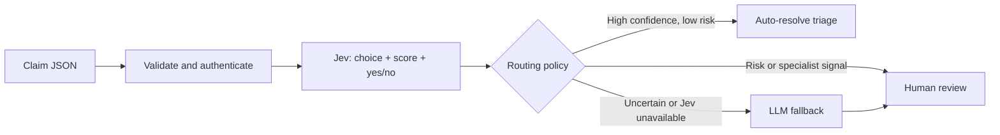
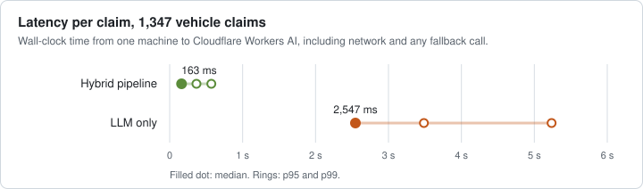
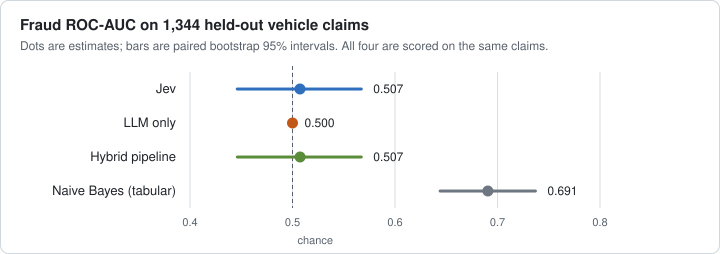
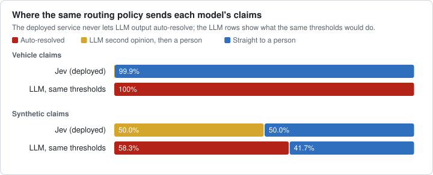

# ClaimSignal

### Real-Time Claims Triage with Jev

**Status: Actively working on this project right now.**

ClaimSignal is a TypeScript insurance claims triage service for Cloudflare Workers AI. It uses TypeSafe AI's Jev, a non-autoregressive System One model, to classify claim type, score fraud indicators, and make typed, probabilistic decisions instead of parsing free-text LLM output.

The first implementation includes a Jev adapter, confidence-based routing, an LLM fallback, an authenticated HTTP API, and a reproducible benchmark harness. Live Cloudflare runs are measured in the [live comparison report](reports/live-comparison.md).

## How it works



Jev evaluates three independent questions against the same claim in one call:

| Decision | Primitive | Application value |
| --- | --- | --- |
| Claim type | `choice` | Auto, property, health, travel, or other |
| Fraud indicators | `score` | Five-level rubric normalized to 0–1 |
| Review needed | `noul` (yes/no) | Probability of missing facts, conflict, injury, or specialist need |

The fraud score measures a position on a rubric; it is **not** a calibrated probability that someone committed fraud. Jev confidence describes its output distribution, not a guarantee of correctness.

## Full public dataset and measured baseline

The repository now includes the complete [Vehicle Insurance Claim Fraud Detection dataset](https://www.kaggle.com/datasets/shivamb/vehicle-claim-fraud-detection): **15,420 historical auto-insurance records, including 923 fraud labels**. See the [dataset card](data/README.md) for its source, CC0 attribution, pinned checksum, input fields, and limitations.

```bash
npm run dataset:check       # Validate and adapt every record
npm run dataset:evaluate    # Train/validate/test a real offline baseline
```

The offline baseline uses 9,224 training, 3,186 validation, and 3,010 held-out test records. Its measured test ROC-AUC is **0.7210**, with **15.28% fraud precision** and **24.86% fraud recall**. These are a modest starting point, not production performance. [Full measured results](reports/README.md).

The dataset is also wired into the Jev-versus-LLM runner:

```bash
node --env-file=.env benchmarks/run.ts --dataset=vehicle --split=test --limit=20
```

Remove `--limit=20` to evaluate the complete test partition. Use `--split=all` for the full corpus. Live evaluation requires Cloudflare credentials. Dataset labels never enter model inputs. This auto-only dataset cannot validate health, travel, or property classification, and its field-rendered descriptions are not original claimant narratives.

## Measured live comparison

Jev and `@cf/meta/llama-3.1-8b-instruct-fp8` were run on Workers AI against the same claims: a 1,347-claim sample of the held-out vehicle split and 12 synthetic claims run five times each. Brackets are paired bootstrap 95% intervals. [Full report and reproduction](reports/live-comparison.md).

| | Jev / hybrid | LLM only |
| --- | ---: | ---: |
| Median latency, vehicle | 163 ms | 2,547 ms |
| Estimated cost per 1,000 vehicle claims | $0.033 | $0.091 |
| Failed calls, vehicle | 0 of 1,347 | 3 of 1,349 |
| Claim type correct, synthetic | 100% | 91.7% |
| Fraud ROC-AUC, vehicle | 0.507 [0.446, 0.567] | 0.500 (constant score) |

- Jev is about 16 times faster and 2.7 times cheaper as the primary call, and it classified every synthetic claim correctly.
- Neither language model ranks historical fraud on field-rendered claims. A Naive Bayes model scored on the same claims reaches 0.691 [0.644, 0.737].
- At the current thresholds Jev auto-resolves nothing; it sends 99.85% of vehicle claims straight to review. The LLM reports full confidence, so the same thresholds would auto-resolve every vehicle claim, fraud-labelled ones included.
- The vehicle run stopped at the Workers Free plan's daily allocation. The remaining 1,663 test claims can be resumed with `--offset=1347`.







The figures are drawn from the committed checkpoints by `npm run report:live`, and CI fails if they or the comparison files drift from the data.

## Routing policy

| Condition | Outcome |
| --- | --- |
| Type and risk confidence ≥ 0.85, fraud score ≤ 0.25, review probability ≤ 0.10, known category | `auto_resolved` |
| Fraud score ≥ 0.70 or review probability ≥ 0.80 | `human_review`, without an LLM call |
| Any remaining uncertainty, invalid primary response, or primary timeout | LLM suggestion followed by `human_review` |
| Both providers fail | `human_review` with an explicit failure reason |

Thresholds live in [`src/triage.ts`](src/triage.ts). They are starting values requiring evaluation on representative claims. LLM confidence is self-reported and cannot override the review gate.

`auto_resolved` means the **triage decision** is resolved. This service does not approve coverage, deny claims, or issue payments. `human_review` is a returned disposition; the calling application must persist it in its review queue. A persistent queue and reviewer UI are planned.

## Run locally

Requires Node.js 22.18+ and npm.

```bash
npm ci
npm run typecheck
npm test
npm run benchmark -- --mock
```

The mock benchmark is a deterministic fixture oracle that checks report generation. Its accuracy and latency values are **not model measurements** and should not be used as performance claims.

To run the Worker with live inference, authenticate a Cloudflare account with Workers AI access:

```bash
npx wrangler@4.141.0 login
# Create .dev.vars with TRIAGE_API_KEY="a-long-random-local-secret"
npm run dev
```

The dev/deploy scripts download pinned Wrangler on first use. Workers AI calls use the remote service and can incur charges even when the Worker runs locally. The implementation uses the documented `typesafe/jev` model identifier; availability and access depend on your Cloudflare account.

```bash
curl http://localhost:8787/v1/triage \
  -H "Authorization: Bearer $TRIAGE_API_KEY" \
  -H 'Content-Type: application/json' \
  --data @examples/claim.json
```

Set `TRIAGE_API_KEY` in your shell to the same value as `.dev.vars` before running the curl command. `GET /health` is public and only reports that the Worker is responding; it does not check provider readiness.

The response includes `claimId`, `route`, `reason`, `decision`, `fallbackDecision`, provider attempts with timing and usage, a request ID, and a policy version. Unknown amounts and currencies may both be `null`; known amounts retain their numeric value and currency. Responses are not cached. Invalid requests fail before inference; the endpoint limits bodies to 32 KiB and descriptions to 8,000 characters.

## Benchmark against an LLM-only baseline

The harness sends the same synthetic claims and rubrics through the hybrid pipeline and the configured Workers AI LLM. Call order alternates per case. It reports p50/p95 end-to-end latency, classification accuracy, normalized risk mean absolute error, automatic routing rate, errors, and estimated token cost. Hybrid latency and cost include fallback calls.

```bash
cp .env.example .env
# Fill in Cloudflare credentials and current per-million-token prices.
BENCHMARK_REPEATS=3 node --env-file=.env benchmarks/run.ts
```

Reports are written to the ignored `benchmark-results/` directory. Missing prices, missing usage, and failed calls produce `null` cost rather than a misleading zero. The harness does not retry model failures and retains them in the accuracy denominator. Calls rejected by Cloudflare's account rate limiter (HTTP 429) are not model failures: the pair is set aside in a `.throttled.jsonl` checkpoint and repeated after a pause, and a spent daily allocation stops the run with a `stopReason`. Resume with `--offset=N`, then compare merged checkpoints with `npm run benchmark:compare -- first.jsonl resumed.jsonl`. The default run uses 12 hand-authored smoke fixtures; use `--dataset=vehicle` for the full public dataset. See [benchmark methodology](docs/benchmarking.md).

## Deploy

```bash
npx wrangler@4.141.0 secret put TRIAGE_API_KEY
npm run deploy
```

Configure `JEV_MODEL` and `LLM_MODEL` in `wrangler.jsonc`. Runtime inference uses the `AI` binding, so no provider token is embedded in the Worker. Before using real claims, add persistent review delivery, access controls for reviewers, rate limits, retention policies, and evaluation on approved data.

## Project layout

```text
src/domain.ts       Claims, typed results, runtime validation
src/jev.ts          Typed Jev questions and response validation
src/llm.ts          Validated JSON fallback adapter
src/triage.ts       Confidence policy, escalation and deadlines
src/worker.ts       Authenticated HTTP endpoint
benchmarks/         Dataset adapters, paired runner, baseline and metrics
data/               Full public CSV and provenance
reports/            Offline baseline and live comparison results
tests/             Routing, adapter, HTTP and metric tests
```

## Currently working on

- [x] Typed Jev classification, score, and yes/no adapter
- [x] Confidence routing and LLM-assisted human review
- [x] Worker API, input limits, authentication, and failure handling
- [x] Benchmark harness and automated tests
- [x] Live Cloudflare integration smoke test
- [x] Full public auto-claims dataset, grouped partitions, and measured offline baseline
- [ ] Representative multi-line narratives and live Jev threshold calibration
- [x] Measured latency, accuracy, and cost comparison (sample of the held-out split)
- [ ] Live comparison on the remaining held-out claims
- [ ] Durable review queue, idempotent submission, and reviewer workflow

## References

- [Cloudflare: Jev model and binding usage](https://developers.cloudflare.com/ai/models/typesafe/jev/)
- [TypeSafe: System One API](https://docs.typesafe.ai/api/system-one)
- [TypeSafe: score semantics](https://docs.typesafe.ai/primitives/score)
- [TypeSafe: confidence and probability](https://docs.typesafe.ai/confidence)

MIT licensed. Built by [Sanket Muchhala](https://github.com/sanketmuchhala).
