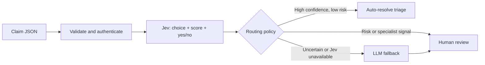

# ClaimSignal

### Real-Time Claims Triage with Jev

**Status: Actively working on this project right now.**

ClaimSignal is a TypeScript insurance claims triage service for Cloudflare Workers AI. It uses TypeSafe AI's Jev, a non-autoregressive System One model, to classify claim type, score fraud indicators, and make typed, probabilistic decisions instead of parsing free-text LLM output.

The first implementation includes a Jev adapter, confidence-based routing, an LLM fallback, an authenticated HTTP API, and a reproducible benchmark harness. **Live Cloudflare validation and real performance measurements are still pending.**

## How it works



Jev evaluates three independent questions against the same claim in one call:

| Decision | Primitive | Application value |
| --- | --- | --- |
| Claim type | `choice` | Auto, property, health, travel, or other |
| Fraud indicators | `score` | Five-level rubric normalized to 0–1 |
| Review needed | `noul` (yes/no) | Probability of missing facts, conflict, injury, or specialist need |

The fraud score measures a position on a rubric; it is **not** a calibrated probability that someone committed fraud. Jev confidence describes its output distribution, not a guarantee of correctness.

## Routing policy

| Condition | Outcome |
| --- | --- |
| Type and risk confidence ≥ 0.85, fraud score ≤ 0.25, review probability ≤ 0.10, known category | `auto_resolved` |
| Fraud score ≥ 0.70 or review probability ≥ 0.80 | `human_review`, without an LLM call |
| Any remaining uncertainty, invalid primary response, or primary timeout | LLM suggestion followed by `human_review` |
| Both providers fail | `human_review` with an explicit failure reason |

Thresholds live in [`src/triage.ts`](src/triage.ts). They are starting values requiring evaluation on representative claims. LLM confidence is self-reported and cannot override the review gate.

`auto_resolved` means the **triage decision** is resolved. This service does not approve coverage, deny claims, or issue payments. `human_review` is a returned disposition; the calling application must persist it in its review queue. A persistent queue and reviewer UI are planned.

## Run locally

Requires Node.js 22.18+ and npm.

```bash
npm ci
npm run typecheck
npm test
npm run benchmark -- --mock
```

The mock benchmark is a deterministic fixture oracle that checks report generation. Its accuracy and latency values are **not model measurements** and should not be used as performance claims.

To run the Worker with live inference, authenticate a Cloudflare account with Workers AI access:

```bash
npx wrangler@4.141.0 login
# Create .dev.vars with TRIAGE_API_KEY="a-long-random-local-secret"
npm run dev
```

The dev/deploy scripts download pinned Wrangler on first use. Workers AI calls use the remote service and can incur charges even when the Worker runs locally. The implementation uses the documented `typesafe/jev` model identifier; availability and access depend on your Cloudflare account.

```bash
curl http://localhost:8787/v1/triage \
  -H "Authorization: Bearer $TRIAGE_API_KEY" \
  -H 'Content-Type: application/json' \
  --data @examples/claim.json
```

Set `TRIAGE_API_KEY` in your shell to the same value as `.dev.vars` before running the curl command. `GET /health` is public and only reports that the Worker is responding; it does not check provider readiness.

The response includes `claimId`, `route`, `reason`, `decision`, `fallbackDecision`, provider attempts with timing and usage, a request ID, and a policy version. Responses are not cached. Invalid requests fail before inference; the endpoint limits bodies to 32 KiB and descriptions to 8,000 characters.

## Benchmark against an LLM-only baseline

The harness sends the same synthetic claims and rubrics through the hybrid pipeline and the configured Workers AI LLM. Call order alternates per case. It reports p50/p95 end-to-end latency, classification accuracy, normalized risk mean absolute error, automatic routing rate, errors, and estimated token cost. Hybrid latency and cost include fallback calls.

```bash
cp .env.example .env
# Fill in Cloudflare credentials and current per-million-token prices.
BENCHMARK_REPEATS=3 node --env-file=.env benchmarks/run.ts
```

Reports are written to the ignored `benchmark-results/` directory. Missing prices, missing usage, and failed calls produce `null` cost rather than a misleading zero. The harness makes no retries and retains failures in the accuracy denominator. There are 12 hand-authored synthetic fixtures; they are useful for development, not evidence of production accuracy. See [benchmark methodology](docs/benchmarking.md).

## Deploy

```bash
npx wrangler@4.141.0 secret put TRIAGE_API_KEY
npm run deploy
```

Configure `JEV_MODEL` and `LLM_MODEL` in `wrangler.jsonc`. Runtime inference uses the `AI` binding, so no provider token is embedded in the Worker. Before using real claims, add persistent review delivery, access controls for reviewers, rate limits, retention policies, and evaluation on approved data.

## Project layout

```text
src/domain.ts       Claims, typed results, runtime validation
src/jev.ts          Typed Jev questions and response validation
src/llm.ts          Validated JSON fallback adapter
src/triage.ts       Confidence policy, escalation and deadlines
src/worker.ts       Authenticated HTTP endpoint
benchmarks/         Synthetic fixtures, paired runner and metrics
tests/             Routing, adapter, HTTP and metric tests
```

## Currently working on

- [x] Typed Jev classification, score, and yes/no adapter
- [x] Confidence routing and LLM-assisted human review
- [x] Worker API, input limits, authentication, and failure handling
- [x] Benchmark harness and automated tests
- [ ] Live Cloudflare integration smoke test
- [ ] Representative labeled dataset and threshold calibration
- [ ] Measured latency, accuracy, and cost comparison
- [ ] Durable review queue, idempotent submission, and reviewer workflow

## References

- [Cloudflare: Jev model and binding usage](https://developers.cloudflare.com/ai/models/typesafe/jev/)
- [TypeSafe: System One API](https://docs.typesafe.ai/api/system-one)
- [TypeSafe: score semantics](https://docs.typesafe.ai/primitives/score)
- [TypeSafe: confidence and probability](https://docs.typesafe.ai/confidence)

MIT licensed. Built by [Sanket Muchhala](https://github.com/sanketmuchhala).
