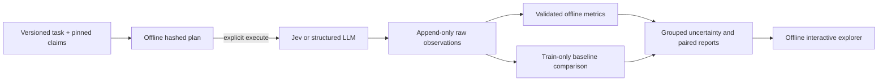

# ClaimSignal experiments

ClaimSignal remains a claims application and an applied Jev research project. The goal is to understand bounded decisions, calibration, abstention, and workflow tradeoffs. Commercial validation is outside this work.

## Quick start

Requires Node.js 22.18 or later and npm. All six tasks can be planned and all committed reports can be regenerated without credentials or model calls.

```bash
npm ci
npm run typecheck
npm test
npm run experiment -- --help
npm run experiment -- --task=vehicle-fraud-choice-v1 --limit=20
```

The last command prints a deterministic JSON plan for 20 validation claims. Labels are stored in the plan for analysis but excluded from each model request. Inspect the task, claims, split, and hash before choosing whether to make live calls.

For a bounded Jev run, put Cloudflare Workers AI credentials in the ignored `.env` file (start from `.env.example`) and use a fresh output directory:

```bash
node --env-file=.env experiments/run.ts \
  --task=vehicle-fraud-choice-v1 --limit=20 \
  --execute --out=experiment-results/fraud-choice-validation-01
npm run experiment:report -- \
  --run=experiment-results/fraud-choice-validation-01 \
  --out=experiment-results/fraud-choice-validation-01/report.json
npm run experiment:compare -- \
  --run=experiment-results/fraud-choice-validation-01 \
  --out=experiment-results/fraud-choice-validation-01/comparison.json
npm run experiment:uncertainty -- \
  --run=experiment-results/fraud-choice-validation-01 \
  --out=experiment-results/fraud-choice-validation-01/uncertainty.json
npm run experiment:explore -- \
  --run=experiment-results/fraud-choice-validation-01 \
  --out=experiment-results/fraud-choice-validation-01/explorer.html
```

**Live inference can use Cloudflare quota and may incur charges.** Start with a small declared limit. The output directory must not already exist; each command refuses to overwrite its output. The first run stores the fixed plan, exact requests and raw provider responses, model metadata, timing, token usage, errors, and completion counts. Analysis and the explorer make no provider calls.

The experiment CLI does not resume a partial run. It checkpoints each attempted claim to disk, so you can analyze a partial run; rerunning needs a new directory and will submit its planned calls again. By default HTTP 429 is recorded and stops the run. `--rate-limit-retries=N` enables 0–10 exponential-delay retries for 429 responses only; use it only when account throttling is temporary. The daily allocation error stops even with retries enabled. Authorization errors stop immediately.

For comparison experiments, use the **same task, split, and limit** for each run. Capture a Jev run and an LLM run to separate fresh directories, then pair them:

```bash
node --env-file=.env experiments/run.ts \
  --task=vehicle-fraud-choice-v1 --limit=20 --execute \
  --provider=llm --model=@cf/meta/llama-3.3-70b-instruct-fp8-fast \
  --out=experiment-results/fraud-choice-llm-01
npm run experiment:paired -- \
  --left=experiment-results/fraud-choice-validation-01 \
  --right=experiment-results/fraud-choice-llm-01 \
  --out=experiment-results/fraud-choice-paired.json
```

The model ID above is an example; confirm that the requested model is available to your Cloudflare account. The experiment does not silently substitute another model. Keep model selection, limits, and any departures in the resulting report.

## Experiment lifecycle and artifact layout



The plan hash covers the task definition, question order, selected inputs, and labels. A separate request hash covers exactly the state and question sent to the model, and the evaluator verifies that raw responses decode to the saved answer. Vehicle plans retain target labels locally in `plan.json` but build requests from `state` only. Raw responses are not edited to fix mistakes or malformed JSON.

| File | What it contains |
| --- | --- |
| `plan.json` | Versioned task, dataset checksum, partition, sample order, inputs, local targets, groups, and plan hash |
| `run.json` | Requested provider/model, adapter, actual Git revision and dirty-tree status, timestamp, runtime, and retry policy |
| `observations.jsonl` | One checkpoint per attempted claim: request hash, timing, status, untouched raw response, decoded answer, resolved model when reported, token usage, and sanitized errors |
| `completion.json` | Planned, attempted, successful, failed, unattempted, 429 retry, and stop counts |
| Derived reports | Validated metrics, labels/predictions, paired comparisons, calibration/abstention data, and bootstrap intervals |

When a run is interrupted, earlier JSONL rows are durable. There is no resume operation: running again submits the selected claims again and must use a new directory. An absent `completion.json` marks the run as incomplete. Provider errors, invalid generated JSON, and unattempted claims stay distinct. Authorization or spent-allocation errors stop immediately. Generic failures do not expose provider exception text because it could contain sensitive request details.

Live call latency is wall time for an individual request and includes sleep/wake delays if the host goes to sleep. Reported token usage is not dollar cost. New experiment outputs have `costUsd: null` until the rate assumptions are declared and wired into that report; never describe unknown cost as zero.

## Reading the metrics

No single number describes all parts of a decision system.

| Question | Measures | What a good score does not tell you |
| --- | --- | --- |
| Does the model rank positives above negatives? | ROC-AUC; average precision, with outcome prevalence | Whether probabilities are numerically calibrated or a deployment threshold is safe |
| Are binary probabilities accurate? | Brier score; log loss; reliability bins and expected calibration error | Whether a ten-bin diagram is stable on a small or imbalanced sample |
| Can uncertainty support abstention? | Error/rubric loss at each confidence threshold; coverage counts all planned claims | Whether one-call confidence is stable across repeat runs |
| Can it select a class? | Choice accuracy, multiclass Brier sum, log loss, top-label reliability | Whether one class or language subgroup is failing; check per-class counts |
| Can it place a value on an ordered rubric? | Mean absolute error in rubric positions; normalized ranked probability score over the ordered levels | Whether a rubric position is an event probability |
| Is it operationally useful? | Successful/failed calls, unattempted count, p50/p95 latency, reported tokens | Total cost when prices are unavailable, or human review quality |

Binary Choice is measured using the designated positive-option probability; Noul is measured using its yes probability. Both use a fixed `p >= 0.5` threshold for the common classification view. Probability distributions rounded by Jev may not sum to exactly 1; the analysis normalizes a copy for distribution metrics and retains the raw values. Log loss floors zero probabilities at `1e-15`. Choice `confidence` is reported as a separate uncertainty statistic, never a correctness probability. LLM-generated probabilities and self-reported confidence are kept separate from Jev's outputs.

Calibration is agreement between predicted probability and observed frequency. It is different from discrimination/ranking. ECE depends on the binning choice and can look deceptively small with tiny bins or single-class samples. The analysis reports bin sizes and emits a warning when an evaluated binary class is absent; ROC-AUC is then undefined. Read label counts and answered share alongside all metrics.

Abstention curves accept whole ties together. Their coverage denominator is the full planned sample, so provider failures and unattempted claims reduce coverage. Paired model metrics use claims both models answered and show that count separately. A failed output is never imputed as a negative prediction.

## Adding or changing an experiment

1. Define what the label means, where it comes from, and what the example input contains. Verify that inputs do not leak the target or post-outcome fields.
2. Add a frozen definition to `experiments/tasks.ts`. Give any changed question a new task ID/version; do not edit a version after a report has been committed.
3. Map each target from the pinned source in `experiments/plan.ts`, or explicitly label an existing fixture task `synthetic`/`smoke`. If a real ground-truth label does not exist, represent it as unknown; do not invent one.
4. Add meaningful parser, target exclusion, hash, metric, failure, and baseline checks. Test doubles verify code paths and must remain marked as test doubles in every report.
5. Generate the plan offline, inspect it, declare the sample and analysis before inference, then run the smallest useful live batch. Keep the exact plan and raw responses with any result you publish.

If a change affects the production API or routing policy, evaluate and review that separately from experiments. A research result does not silently update the Worker or its thresholds.

## Baseline audit — 2026-10-24

Baseline commit: `d9e130d`. The working tree was clean before this work. Existing Worker routes, D1 review delivery, tabular model, prompts, fixtures, dataset bytes, and published reports remain the baseline. Use `git show d9e130d:<path>` to inspect an original file without changing the working tree.

- All 41 tests and TypeScript checks pass. The repository has no separate build script; TypeScript runs without emitting and Node executes TypeScript directly.
- Mock harness, full dataset validation, offline model regeneration, and live-report regeneration pass with no tracked differences. Mock output is a plumbing check, never model evidence.
- The vehicle dataset has 15,420 historical records, fixed grouped partitions, and fraud outcome labels. It does not label review need, narrative completeness, or rubric severity. The held-out split has already been examined in earlier research; new exploratory experiments must disclose that exposure.
- There are now 24 authored synthetic claims. These measure behavior against author expectations, not population performance. Repeated calls do not increase the number of independent claims.
- `benchmarks/review-questions.ts` already compares compound and decomposed review questions. Its v2 maximum of four probabilities is a routing statistic, not a probability of the union of those events.
- `src/jev.ts` validates distributions but returns only selected values. Experiments need an independent capture layer that retains raw responses without changing the production contract.

## First milestone

1. Audit and research protocol (this document).
2. Versioned claims experiment definitions, provenance, and deterministic manifests.
3. Explicit live execution with full response capture, failure accounting, and offline planning.
4. Offline calibration and abstention reports with tested metric semantics.

Subsequent independent milestones: matched deterministic/ML and LLM comparisons; question decomposition, wording/order and distractor experiments; grouped uncertainty estimates; interactive result and failure exploration. Do not build these before their inputs are trustworthy.

The milestones above describe the original implementation plan. The later sections and validation-study report show which subsequent pieces have since been added and measured.

## Frozen claims tasks

Task prompts and labels are versioned in `experiments/tasks.ts`. Change the ID/version when changing a task's meaning. `--help` prints the canonical IDs.

| Task ID | Input and target | Question primitive | Interpretation and limits |
| --- | --- | --- | --- |
| `vehicle-fraud-choice-v1` | Rendered vehicle fields; historical fraud label | Two-option Choice | Fraud ranking on this old tabular dataset; not fraud evidence in narrative text |
| `vehicle-fraud-noul-v1` | Same records, labels, and order as fraud Choice | Yes/no Noul | Same historical outcome; prompt includes an extra question sentence, so the contrast does not isolate the primitive |
| `vehicle-evidence-score-v1` | Same records; count of two supplied Yes/No fields | Three-level Score | Transparent fact-reading positive control, not fraud prediction or claim complexity; some levels may be absent from a sample |
| `claims-type-choice-v1` | Existing author-written claims fixtures and author category | Five-option Choice | Synthetic smoke only; no population inference |
| `claims-review-noul-v1` | Same fixtures and author review-needed label | Yes/no Noul | Synthetic smoke only; not independently adjudicated review truth |
| `claims-inconsistency-score-v1` | Same fixtures and author rubric answer | Five-level Score | Rubric severity position, not fraud probability |

Vehicle plans default to the validation partition and synthetic plans default to `smoke`. A requested split must be supported by the task. Plans select the first N IDs in sorted order, independent of labels, and reject limits larger than the available split. For historical tasks, use the configured train/validation/test partitions; fitting a baseline on its evaluation records is rejected. `test` has been examined in prior work and exploratory results on it must disclose that exposure.

The source dataset has 15,420 vehicle claims and 923 fraud labels. It contains no original claimant narratives, gold review labels, or rubric severity labels. Its grouped random partitions are not a temporal holdout. See the [dataset card](../data/README.md). Historical fraud labels are not sent in model requests. Synthetic fixtures are never substituted for missing real labels.

## What each primitive means here

- **Choice** selects one option and returns a distribution across those options. Assess category accuracy or, for the binary fraud task, the probability of the designated `yes` outcome. Option accuracy, probability calibration, and high confidence are different things.
- **Noul** returns the probability that a specific yes/no statement is true. Brier score, log loss, calibration bins, and threshold behavior can be compared with binary labels. A probability over one event is not an ordinal severity rating.
- **Score** returns a position on an ordered rubric and a distribution over rubric levels. Compare with explicitly ordered labels using absolute rubric error and the normalized ranked probability score. The score position is not a probability of fraud.
- Jev's `confidence` for Choice and Score summarizes its output distribution. It is not the empirical probability that the answer is correct. Noul has no separate confidence field. For an LLM, generated probabilities and self-reported confidence are estimates, not Jev-style probabilities.

For each task, compare a model with a baseline suited to the task. Fraud labels have a training-prior and categorical Naive Bayes baseline fit on train only. Field counting has an exact deterministic baseline. Synthetic author labels are useful for exercising adapters, not estimating real-world quality.

## Research protocol

- Keep historical reports immutable. New artifacts live in `experiment-results/` and must identify their dataset, labels, question definitions, model, input hashes, and code revision.
- Separate historical outcome prediction from reading explicitly supplied facts. A deterministic parser is the correct baseline for fact-reading tasks; success there is not evidence of predicting fraud.
- Use the existing vehicle partitions. Default new exploration to validation. Freeze task/threshold choices before test evaluation, and disclose prior test exposure. Do not tune on test curves.
- Synthetic tasks must say **synthetic smoke** in plans and reports. Never substitute them for real records when data is missing. Unknown labels stay unknown.
- Choice probabilities and Noul event probabilities can be evaluated against corresponding labels. Vendor `confidence` is a distribution statistic, not the probability of correctness. Score is a position on an ordered rubric, not a fraud probability.
- Preserve unmodified raw distributions. If rounding requires normalization for metrics, describe it and preserve the original values. Report missing/failed calls and coverage denominators.
- Calibration and predictive discrimination are different. Threshold tuning alone does not calibrate probabilities. Calibration plots on small or imbalanced samples are descriptive only.
- Use unique claims/groups for uncertainty analysis; keep repetitions and transformations grouped with their original claim. No confidence intervals based on treating repeats as independent examples.
- No invented latency, costs, predictions, or customer outcomes. Offline fixture responses test code only. Live calls require an explicit execution command and a bounded manifest; never run on import or in CI.

## Running the first experiments

`npm run experiment -- --help` lists tasks. Planning is offline and defaults to 20 validation records (or explicitly labeled synthetic smoke cases):

```bash
npm run experiment -- --task=vehicle-fraud-choice-v1 --limit=20
npm run experiment -- --task=vehicle-fraud-noul-v1 --limit=20
npm run experiment -- --task=vehicle-evidence-score-v1 --limit=20
```

The first two predict the same historical outcome on identical inputs. The score task counts two explicit Yes fields: a field-reading control with deterministic ground truth, not a fraud score. Three `claims-*` tasks use the existing synthetic fixtures for category, review need, and inconsistency severity. No datasets are silently interchanged.

For an intentional live run (may incur charges):

```bash
node --env-file=.env experiments/run.ts --task=vehicle-fraud-choice-v1 --limit=20 --execute --out=experiment-results/fraud-choice-validation-01
```

The output directory must be new. Each run saves `plan.json`, `run.json`, append-only `observations.jsonl`, and `completion.json`. Raw responses and rounded distributions are retained, along with actual resolved model version where available, usage, timing, request hashes, Git revision, and dirty-tree status. Credentials are never written. By default, a rate limit or authorization failure stops execution; other errors are explicit failed observations. Interrupted runs can be inspected without a completion file. Reruns use a new directory, never overwrite original evidence.

Cloudflare's per-minute throttling returns HTTP 429 before any inference runs. `--rate-limit-retries=N` (0–10, default 0) waits `EXPERIMENT_THROTTLE_PAUSE_MS` (default 30 s), doubling each time, and retries that claim. Throttled attempts are never recorded as observations; `completion.json` counts them as `rateLimitRetries`, and `run.json` states the policy. A spent daily allocation still stops the run.

## Offline analysis

```bash
npm run experiment:report -- --run=experiment-results/fraud-choice-validation-01 --out=experiment-results/fraud-choice-validation-01/report.json
```

The reporter makes no model calls, refuses to overwrite a report, checks request identity, rejects duplicate claims and model-version drift, and re-parses raw responses. It can analyze interrupted runs without `completion.json`; truncated JSON lines cause an error rather than silent omission.

- Binary tasks: Brier score, clipped log loss, event reliability bins/ECE, discrimination, fixed 0.5 threshold, and top-label reliability. Binary Choice and Noul use the same threshold, including ties; the raw selected option remains visible.
- Category tasks: accuracy, class-summed Brier score, log loss, and top-label reliability.
- Score tasks: MAE in rubric units and normalized ranked probability score (mean squared cumulative probability error over the K−1 boundaries). Numeric rubric positions are never evaluated as event probabilities.
- Abstention: loss versus coverage, separately ranked by predicted-class probability and vendor confidence where available. Entire confidence ties enter together. The denominator is all planned claims, including failed and unattempted calls. Ordinal curves use rubric MAE, not classification accuracy.
- Reported probabilities rounded by Jev are normalized by their sum for distribution metrics only. Raw values remain unchanged; the number of affected responses is reported. Log loss uses a stated 1e-15 probability floor for zero-probability outcomes.
- Small-sample plots and ECE do not establish calibration. Reports include bin sizes, class prevalence, failure counts, unique groups, and per-claim errors. The separate grouped-uncertainty command gives sampling intervals; no thresholds are calibrated or tuned by these tools.

## Matched offline baselines

```bash
npm run experiment:compare -- --run=experiment-results/fraud-choice-validation-01 --out=experiment-results/fraud-choice-validation-01/comparison.json
```

For vehicle fraud, this computes the existing categorical Naive Bayes algorithm and a constant training-prevalence predictor. Both use only the 9,224 training records for fitting. For the evidence-count task, it counts the two source fields directly. Inputs and targets are checked against the pinned dataset before comparison; the baseline cannot silently receive different records. Training split evaluation is rejected.

The artifact records training IDs/model hashes, every baseline prediction, full-sample summaries, and paired summaries on successful model cases. Errors and unattempted cases stay visible; missing model outputs never become negative predictions. Baseline probability scores are evaluated for calibration, not presumed calibrated. No local-compute versus remote-network speed claim is made.

## Paired prompt sensitivity

Use `--variant=choice-order-reversed-v1`, `--variant=paraphrase-v1`, or `--variant=administrative-note-v1` with the same task, split, and limit as a base run. Planning remains offline unless `--execute` is supplied. Option reversal applies only to Choice; paraphrases are defined only for the three historical vehicle tasks. A plan records its parent hash and exact transformation. Variants cannot be stacked.

```bash
npm run experiment -- --task=vehicle-fraud-choice-v1 --limit=20 --variant=choice-order-reversed-v1
npm run experiment:robustness -- --base=experiment-results/base --variant=experiment-results/variant --out=experiment-results/robustness.json
```

The offline comparison verifies the exact declared transformation and same model, then reports paired decision flips, total variation in probability distributions, or absolute changes in rubric score. Unpaired failures remain visible. One response per form does not separate stochastic variation from prompt sensitivity; no statistical significance is claimed. Model outputs and labels are compared in their separate reports. Baselines for transformed inputs are not silently reused; compare those to their unmodified base run explicitly.

## LLM comparison

Use the same task/split/limit, `--provider=llm`, an explicit `--model=<Workers-AI-model>`, and a new output directory with `--execute`. The existing Cloudflare transport is reused. Requests contain exactly the task question and claim state; the raw messages and provider responses are preserved. Generated JSON is validated against the same primitive contract. Malformed JSON remains an invalid response rather than becoming a negative prediction.

`npm run experiment:paired -- --left=<jev-run> --right=<llm-run> --out=<new.json>` verifies identical plans and reports each full run plus metrics on their shared successful cases. `experiment:compare` also works on the LLM run to produce matched deterministic/ML baselines. These are generated probability estimates, not exact next-token probabilities; LLM self-reported confidence is excluded from the Jev-confidence curve. Missing resolved LLM versions are recorded as `unreported:<requested-alias>` and make controlled same-version robustness comparison unavailable.

No new LLM performance is claimed until an explicit live run is captured. Provider choice and model are never silently substituted.

## Grouped uncertainty

```bash
npm run experiment:uncertainty -- --run=<run> [--against=<other-run>] --out=<new.json>
```

Offline 95% percentile bootstrap intervals, 2,000 resamples, fixed seed `20261024`. The resampling unit is the claim group: vehicle claims with identical allowed features resample together, and synthetic fixtures are their own groups, so near-duplicates never count as independent evidence. Each run gets intervals for its answered share and every task metric. Unmodified vehicle runs also get the train-only baselines on the claims the model answered, with model − baseline differences from the same resamples.

`--against` compares two captures on the same claims, such as Jev against an LLM, or Choice against Noul. The plans must use the same dataset, split, selection and target kind, and one plan's claims must be the first claims of the other's; a different selection is refused. Differences use the claims both sides answered, and answered shares are compared separately. An interval is omitted when its statistic is undefined in more than 1% of resamples, such as ROC-AUC on a resample with no positive outcome. Reports state the number of groups and answered positives, warn below 30 groups or 10 positives, and make no multiple-comparison adjustment or significance claim. With one call per claim, intervals describe sampling variability, not run-to-run model variation.

## Offline interactive explorer

```bash
npm run experiment:explore -- --run=reports/experiments/pilot-20261024/choice --run=reports/experiments/pilot-20261024/noul --run=reports/experiments/pilot-20261024/score --out=experiment-results/pilot.html
```

Open the generated HTML file in a browser. It embeds verified captures and uses no network resources. Select a task, inspect event or top-label reliability, move the abstention threshold, filter wrong/failed/unattempted cases, and inspect each claim's input and raw answer. Model changes, missing classes, synthetic/test-double provenance, and source revision stay visible. The threshold control is exploratory and does not tune or change the production policy. The file contains source claims, so share it only with the same care as its input dataset.

## Primitive references

Checked 2026-10-24: [Choice](https://docs.typesafe.ai/primitives/choice), [Score](https://docs.typesafe.ai/primitives/score), [Noul](https://docs.typesafe.ai/primitives/noul), and [confidence semantics](https://docs.typesafe.ai/confidence). The experiment protocol tests model quality rather than assuming vendor calibration claims. The [independent Jev paper](https://arxiv.org/abs/2609.37647) supplies reproduction hypotheses; its results do not establish claims-domain performance.
